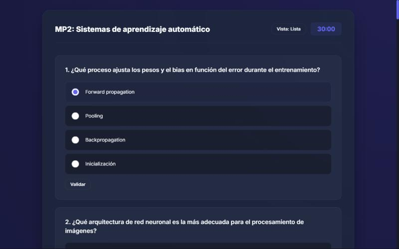

# Neural Networks Quiz

An interactive exam app I built to prepare for my **Master's in AI & Big Data**. It turns JSON question banks into timed tests on machine learning, neural networks and generative AI.



## Features

- **Exams per topic**: pick a folder (Topic 3, Topic 4, MP2) and then an exam.
- **Timed mode**: a countdown that turns red near the end; the exam is submitted automatically when time runs out.
- **Pass mark** set per exam.
- **Two views**: the whole exam as a list, or one question at a time with a progress tracker.
- **Instant feedback**: validate each question as you go, or submit the whole exam for a final score.
- **Shuffled** questions and answers on every attempt.
- **Study mode**: read every question together with its correct answer.
- **Retry** or switch exams from the results screen.

## Run it

It's a static site: serve the `quiz-app` folder and open it in a browser.

```bash
cd quiz-app
python -m http.server 8000
# open http://localhost:8000
```

## Add your own exams

1. Create a JSON file in `quiz-app/json/<TOPIC>/` following the format of the existing exams (`examen` → `titulo`, `descripcion`, `configuracion`, questions).
2. Register it in `quiz-app/json/exams.json`:

```json
{ "id": "my-exam", "titulo": "My exam", "archivo": "TOPIC/my-exam.json" }
```

## Study notes

My MP2 notes on machine-learning systems (neural networks, activation functions, architectures) are in [`docs/MP2-notes.md`](docs/MP2-notes.md).
